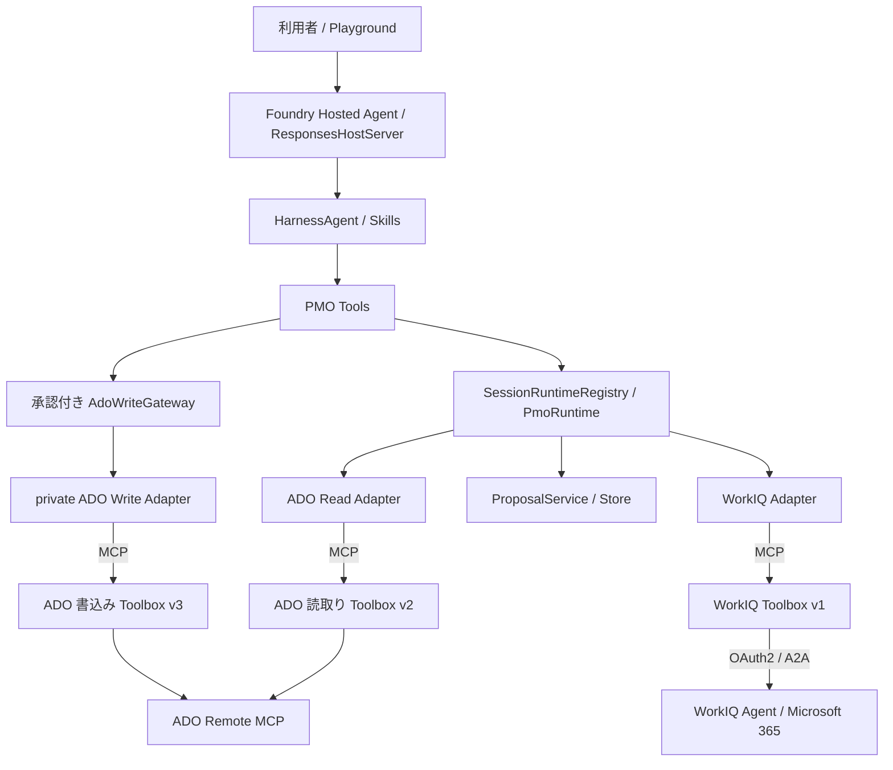

# PMO Agent 基本設計

基準日: 2026-10-09。現在の実装・配備と残課題は [実装状況](IMPLEMENTATION_STATUS.md)、将来の作業は [実装計画](IMPLEMENTATION_PLAN.md) を参照する。本書は全体の責務と境界を定義する。

## 目的

ADO の期限超過した Work Item を観測し、WorkIQ で関連する Microsoft 365 情報を調べ、担当者への状況確認と安全な更新提案を支援する。観測・検索と、メッセージ送信・ADO 変更を分ける。

## アーキテクチャ



### 責務と依存方向

| 層 | 責務 |
| --- | --- |
| Domain / Workflows | Work Item、Proposal、policy、承認束縛、実行状態、監査。特定 SDK に依存しない |
| Skills | observe、ask、propose、apply の業務手順。資格情報や生 MCP 書込みを持たない |
| PMO Tools | モデル向け入力、承認モード、現在の Runtime の解決、標準同意要求 |
| Runtime | Protocol に対する mock / disabled / 実 client の依存注入とセッション分離 |
| Adapters | 操作契約、Project 照合、応答変換、取得失敗・成否不明の処理 |
| Foundry Toolbox / Connection | 下流接続の認証・ユーザー同意。SDK transport が認証とリクエスト call ID を転送 |
| Hosting | Foundry モデル、Responses API、配備と会話状態の受け渡し |

外部文章は参照データとして扱い、その中の命令や承認表現を認可根拠にしない。認可・検証を Skill の指示だけに依存させない。

## モデルに公開する Tool

| Tool | 役割 | 承認 |
| --- | --- | --- |
| `ado_list_overdue_work_items` | 期限超過・未完了の取得 | 不要 |
| `ado_get_work_item` | 現在の ID / revision / fields 取得 | 不要 |
| `workiq_search_task_context` | 関連情報の検索依頼 | ADO 変更承認は不要。OAuth 同意は別 |
| `send_task_status_request` | 担当者への確認依頼 | 設計上は不要。実送信は未実装 |
| `propose_work_item_create/update/comment` | Proposal 作成 | 不要。ADO を変更しない |
| `apply_approved_ado_change` | 承認済み Proposal の適用 | 毎回「今回のみ」、always_require |

FunctionInvocationContext は SDK から注入し、モデルの入力スキーマへ公開しない。生の MCP ツール・汎用ディスパッチャーはモデルへ登録しない。

## ADO 読取りと書込み

読取りは Project を固定して ID / revision / fields を照合する。期限超過判定には確認済みの期限フィールド・完了状態が必要。期限未設定タスクを正常とみなさず、上限・打切りを検出した一覧を全件取得と扱わない。

書込みは `Proposal → 個別承認 → Gateway → private writer` の順。Gateway は session、proposal ID、digest、summary、状態、許可種別・フィールド、revision を検証する。更新・コメントはサーバー側 PATCH の `/rev` Test でも競合を防ぐ。コメントは `System.History` への追記であり、専用 comments API と同一ではない。

成功済み・実行中 Proposal の再利用を拒否する。dispatch 後の timeout / 不正応答 / cancel は成否不明として再利用を禁止し、ADO との照合を必要とする。Remote MCP に冪等性保証があるとは扱わない。現在はインメモリの対話利用であり、再起動・複数プロセスでの耐久性は別途実装する。

詳細は [ADO 読取り](ado-toolbox-read-setup.md) と [ADO 書込み](ado-toolbox-write-setup.md)。

## WorkIQ

PMO → Toolbox は MCP、Toolbox → WorkIQ は既存 RemoteA2A Connection。既存認証の利用と、WorkIQ に自然言語の調査を委ねる用途から採用した。プロトコルの一般的な優劣ではない。

検索前に実 ADO の Project を照合し、ID・タイトル・担当者を固定取得依頼へ入れる。モデル query を自由命令として転送しない。回答は合成回答として扱い、独立した出典がない状態で source ID / 発生日時 / confidence を生成しない。

同意不足は標準 oauth_consent_request に変換する。元の function call へ同意待ちの結果を記録してから実行を停止する。ユーザーの OAuth 同意は ADO 更新の個別承認とは別。WorkIQAgent.Ask は読み取り専用権限ではなく、固定取得依頼も内部の副作用を権限で禁止する保証ではない。

詳細は [WorkIQ 設計](WORKIQ_DESIGN_AND_IMPLEMENTATION.md)。

## 認証・セッション・状態管理

Hosted は managed identity で Foundry へアクセスする。下流ユーザー権限は Connection で扱い、Foundry 権限の付与だけで ADO / WorkIQ の参照権限が得られるとは扱わない。ローカルの実接続では azd 利用者認証を使用する。ADO Remote MCP に PAT は使わない。

MCP session は各操作の現在リクエスト内で生成して閉じ、以前の利用者のコンテキストを保持しない。SessionRuntimeRegistry は AgentSession.session_id で業務状態を分離し、session 不明時は処理を拒否する。

| 状態 | 現在 | 将来 |
| --- | --- | --- |
| 会話・AgentSession | SDK / Foundry Host の履歴・session 機構 | 利用者・再開動作の運用検証 |
| Proposal / Audit | InMemory Store | Cosmos DB の保存・復元・原子的 claim |
| session runtime registry | プロセス内 | durable store から状態を解決 |
| メッセージ重複・送信間隔 | mock のみ | 永続 delivery store |
| 意味記憶 / WorkIQ 回答保存 | 未実装 | 必要性・アクセス制御・保持期間を評価 |

会話・意味記憶を ADO 承認の正本にしない。業務状態・監査・モデル向け記憶を別管理する。

## 未実装の拡張

実メッセージ送信は、宛先と ADO 担当者の照合、重複・頻度制限、監査を備える MessageClient で実装する。Teams 公開はユーザー委任のクライアント構成、Autopilot 等による無人実行はユーザー不在時の identity・ライセンス・下流認証を別途検討する。どちらも今の対話接続成功から可否を推定しない。

## 配備・依存

Microsoft Agent Framework の HarnessAgent、FoundryChatClient、ResponsesHostServer を使用する。固定依存の正本は pyproject.toml / requirements.txt。標準配備は azure.yaml と azd の code deploy、remote build、main.py。Dockerfile は代替経路。

現在の実配備では独自 JSONL trace を無効化している。SDK・プラットフォーム側のログ収集は別の設定であり、本文・認証情報の収集を確認する。環境・操作手順は [環境変数](pmo-agent-environment.md)、[Hosted 配備](foundry-hosting.md) を参照する。

## ソースツリーとファイル別の責務

以下は WorkIQ 機能ブランチ9337145を含む実装全体の構成。`[WorkIQ機能ブランチ]` のファイルは本書と同じ機能ブランチには存在するが、terai-hackathon-devにはまだない。`__init__.py` は各packageに配置する。

```text
fde-hackathon/
├─ src/fde_pmo_agent/
│  ├─ __init__.py
│  ├─ settings.py
│  ├─ runtime.py
│  ├─ domain/
│  │  ├─ models.py
│  │  ├─ policy.py
│  │  └─ errors.py
│  ├─ workflows/
│  │  ├─ ports.py
│  │  ├─ proposal_service.py
│  │  ├─ proposal_store.py
│  │  └─ ado_write_gateway.py
│  ├─ integrations/
│  │  ├─ mock/{ado.py, collaboration.py}
│  │  └─ mcp/
│  │     ├─ ado.py
│  │     ├─ ado_write.py
│  │     ├─ check_ado.py
│  │     ├─ transport.py       [WorkIQ機能ブランチ]
│  │     ├─ workiq.py          [WorkIQ機能ブランチ]
│  │     └─ check_workiq.py    [WorkIQ機能ブランチ]
│  ├─ agent/{factory.py, tools.py, tracing.py}
│  └─ hosting/foundry.py
├─ skills/
│  ├─ observe-task-board/SKILL.md
│  ├─ ask-task/SKILL.md
│  ├─ proposal-task-update/SKILL.md
│  └─ update-task-board/SKILL.md
├─ deploy/foundry/{Dockerfile, agent.yaml, agent.manifest.yaml}
├─ tests/
│  ├─ test_gateway.py
│  ├─ test_agent_tools.py
│  ├─ test_hosting.py
│  ├─ test_settings.py
│  ├─ test_tracing.py
│  ├─ test_trace_settings.py
│  ├─ test_ado_toolbox.py
│  ├─ test_ado_write.py
│  └─ test_workiq_toolbox.py  [WorkIQ機能ブランチ]
├─ docs/                     設計・計画・状態・手順・履歴
├─ azure.yaml
├─ main.py
├─ requirements.txt
├─ pyproject.toml
├─ .agentignore
├─ .dockerignore
├─ .env.example
└─ log/.gitkeep
```

### Domain / Workflows

| ファイル | 主要定義と責務 |
| --- | --- |
| domain/models.py | ChangeOperation、ProposalStatus、PatchOperation、WorkItem、UpdateProposal、AuditEvent。Provider非依存のモデルとProposalのdigest/summary |
| domain/policy.py | AdoWritePolicy。種別・許可フィールド・patch・コメント・対象revisionの検証 |
| domain/errors.py | Proposal不正、承認不一致、競合、成否不明、policy違反、送信違反の例外 |
| workflows/ports.py | AdoClient、WorkIqClient、MessageClientのProtocol。外部接続の差替え境界 |
| workflows/proposal_service.py | create/update/commentのProposal生成、検証、保存 |
| workflows/proposal_store.py | InMemoryProposalStore、InMemoryAuditStore。状態遷移・実行claim・監査の現在の保存先 |
| workflows/ado_write_gateway.py | 承認束縛、policy、revision、排他、監査、成否不明の再利用禁止を強制する唯一のADO書込み境界 |

### Integrations / Runtime / Agent / Hosting

| ファイル | 主要定義と責務 |
| --- | --- |
| integrations/mock/ado.py | ADO取得・期限超過検索・作成・更新・コメントと競合のテスト用実装 |
| integrations/mock/collaboration.py | MockWorkIqClientとMockMessageClient。宛先照合・重複・送信間隔・監査をテストする。実送信はしない |
| integrations/mcp/ado.py | AdoToolboxConfig、AdoMcpClient。実ADO読取りの契約照合、Project・ID・revision・fieldsの正規化、期限超過判定 |
| integrations/mcp/ado_write.py | AdoWriteMcpClient。Gatewayのprivate writerとしてcreate/update/Historyコメント、revision Test、実結果検証 |
| integrations/mcp/transport.py | FoundryToolboxSessionFactory。リクエスト単位の認証・call ID転送・MCP session開閉。旧FoundryAdoSessionFactory名は互換alias |
| integrations/mcp/workiq.py | WorkIqToolboxConfig、WorkIqToolboxClient、WorkIqConsentRequiredError。実ADO照合、固定調査依頼、A2A回答変換、同意・取得エラー |
| integrations/mcp/check_ado.py / check_workiq.py | 明示的な接続確認CLI。ツール契約と指定対象の実取得を確認し、本文・トークンを出力しない |
| runtime.py | PmoRuntime、MockPmoRuntime、SessionRuntimeRegistry、DisabledWorkIqClient、DisabledMessageClient。設定に応じた依存注入とsession分離 |
| agent/factory.py | create_mock_pmo_agent。名称は互換維持しているが実Runtimeも受け取る。Skills・Tools・同意MiddlewareをHarnessへ登録 |
| agent/tools.py | PMO Tool公開面、承認モード、Runtime解決、WorkIqConsentMiddleware。標準同意応答と元callの終端 |
| agent/tracing.py | query、Skill/Tool、結果・例外のJSONL記録、機微値のマスク、長さ制限。実ADOでは無効 |
| hosting/foundry.py | create_azure_credential、create_foundry_agent、create_foundry_host、main。認証・実Adapter・Foundryモデル・ResponsesHostの組立て |
| settings.py | PmoSettings、load_settings。`.env`をoverride=Falseで読み、注入された環境変数を優先・検証 |
| __init__.py | 主要モデル、policy、Gateway、Runtime、factoryのpackage公開API |

M365実送信AdapterとCosmos Storeは未実装。新規実装は既存Protocol・保存境界の背後へ追加し、モックのクラスをそのまま実API実装へ書き換えない。

### Skills と workflow

| Skill | 手順 | 利用する主なTool |
| --- | --- | --- |
| observe-task-board | 期限超過一覧と関連情報を確認し、未記録進捗・根拠不足を説明する | ado_list_overdue_work_items、ado_get_work_item、workiq_search_task_context |
| ask-task | 現在担当者と根拠を確認し状況照会を送る。実送信は未実装 | ado_get_work_item、workiq_search_task_context、send_task_status_request |
| proposal-task-update | 現在revisionを取得しcreate/update/commentの案を保存する | ado_get_work_item、propose_work_item_create/update/comment |
| update-task-board | 今回の承認があるProposalだけ適用する | apply_approved_ado_change |

Skill読み込みはSkillsProviderで行う。Skillの認可文章を信頼境界とせず、宛先・patch・revision・承認内容等はコードで検証する。

### 配備資産とテスト

| 資産 | 責務 |
| --- | --- |
| main.py | code deployのbootstrap。srcをimport pathに追加しhosting.mainを実行 |
| pyproject.toml | package・Python要件・CLI・依存の定義 |
| requirements.txt | Foundry remote buildで使う依存。pyprojectの固定SDKと整合させる |
| azure.yaml | 通常のazd配備の正本。Project/Agent/codeConfiguration/環境変数/resources |
| .agentignore | env、git、venv、ログ、テスト等をupload ZIPから除外 |
| deploy/foundry/agent.yaml | 単体Agent定義。Responses2.0、Python3.14、CPU0.5、Memory1GiB |
| deploy/foundry/agent.manifest.yaml | 再利用可能なAgentとモデルresourceのmanifest |
| deploy/foundry/Dockerfile / .dockerignore | 代替コンテナ配備。Python3.12、非root UID10001、port8088 |
| tests/test_gateway.py | Proposal・policy・承認・競合・二重実行・監査 |
| tests/test_agent_tools.py | Tool承認モード、Skills、観測・提案・mock送信 |
| tests/test_hosting.py | Foundry hostの結線とsession Runtime分離 |
| tests/test_settings.py | 環境変数・`.env`読込み・不足設定 |
| tests/test_tracing.py / test_trace_settings.py | JSONLマスク・上限・結果、実接続でのtrace無効化 |
| tests/test_ado_toolbox.py / test_ado_write.py | 実契約のfake session、認証context、正規化、Gateway経由writer、競合・成否不明 |
| tests/test_workiq_toolbox.py | A2A回答・失敗・同意、元call終端、SDK標準応答・停止、Runtime結線 |

## 主要依存と実行時の生成

| 依存 | 固定版 | 用途 |
| --- | --- | --- |
| agent-framework-core | 1.18.0 | Harness、Skills、FunctionTool、AgentSession、Middleware |
| agent-framework-foundry | 1.13.0 | FoundryChatClient |
| agent-framework-foundry-hosting | 1.0.0b260910 | ResponsesHostServer、FoundryToolbox。プレリリースのため更新時は同意・履歴互換性を検証 |
| azure-identity | 1.25.3 | CLI、azd、managed identity、default credential |
| python-dotenv | >=1,<2 | ローカルenv読込み |

モデルはFoundry Project endpoint、deployment名、資格情報から生成し、default_optionsのstore=Falseを使用する。Hostはhistory_source=agentで生成する。create_mock_pmo_agentというfactory名は業務連携が全てmockという意味ではない。

| AZURE_CREDENTIAL_MODE | 生成する資格情報 |
| --- | --- |
| azd | AzureDeveloperCliCredential。現在のローカル実接続で使用 |
| cli | AzureCliCredential。Azure CLIログインを選ぶ場合 |
| managed_identity | ManagedIdentityCredential。Hostedで明示的に使用 |
| default | DefaultAzureCredential。環境によりVM identityを先に選ぶ可能性がある |

現行Hostedのmodelはgpt-5.6-terra、runtimeはPython3.14、protocolはResponses2.0、CPU0.5・Memory1GiB、port8088。ローカルのreadinessと配備確認の操作は [Hosted手順](foundry-hosting.md) を参照する。

## ADO書込みpolicyと送信policyの詳細

| 対象 | 許可・制限 |
| --- | --- |
| Work Item種別 | Task、Bug、User Story、Product Backlog Item |
| 基本の作成フィールド | System.Title、System.Description、System.AssignedTo、System.IterationPath、System.Tags、Microsoft.VSTS.Scheduling.DueDate |
| 基本の更新フィールド | 作成可能フィールドにSystem.Stateを加える |
| 構成済み期限フィールド | RuntimeでADO_DUE_DATE_FIELDをcreate/update許可へ追加。現在Custom.DueDate |
| モデルからのpatch | add/replaceのみ、/fields/配下の許可フィールド。/rev Testはprivate Adapterが付加 |
| コメント | 空文字不可、最大4000文字。実AdapterはSystem.Historyへ追記 |
| 理由・対象 | 空の理由を拒否。更新・コメントは正のIDとexpected_revisionが必要 |

Proposalはpendingからapplyingを原子的にclaimし、applied/rejectedへ遷移する。policy・revision競合等のdispatch前拒否と、dispatch後の成否不明を区別する。Remote MCPでidempotency keyが保持される保証はない。

mock MessageClientは現在担当者との宛先照合、タスク・宛先・本文から生成する重複キー、同一タスクの送信間隔（初期24時間）、監査を備える。実clientでは同等以上の制約と永続Storeを実装する。mockの成功は実送信の成功とは扱わない。

## Teams公開・無人PMO workerの拡張案

以下は採用済み実装ではなく、将来構成の候補。初期の旧設計で扱っていた2案を維持する。

| 案 | 用途と構成 | 要確認 |
| --- | --- | --- |
| A: Agent主体のworker | Autopilot等を候補にAgent identityで定期観測・担当者へ自律照会 | identityだけでは送信を保証しない。account/license、tenant policy、送信権限、ユーザー不在での下流認証、監査を確認 |
| B: ユーザー対話チャネル | Foundry公開/Activity対応、Azure Bot、Teams app package、ユーザー委任Entra認証 | 公開機能とHosted対応、personal scopeの検証、組織配布と管理者承認、利用者別参照範囲 |

BはAgent自身のTeams accountや無人送信を意味しない。AでもADO更新の個別承認を維持する。現段階ではいずれも未実装で、既存Playground同意の成功から可否を判断しない。採用・実装順序は [今後の計画](IMPLEMENTATION_PLAN.md) で管理する。

## 旧設計からの情報の所在

整理で履歴へ退避した情報を、現在の正本へ次のように配置する。履歴だけに現行の必須情報を残さない。

| 旧設計の内容 | 現行の参照先 |
| --- | --- |
| 全体構成・依存方向・Tool/承認 | 本書のアーキテクチャ・責務・Tool・Gateway節 |
| フォルダ構成・定義・Skill・配備資産・テスト責務 | 本書のソースツリーとファイル別責務 |
| SDK版・資格情報・Runtime/session生成 | 本書の主要依存と実行時の生成 |
| 書込み許可範囲・送信抑止 | 本書のpolicy詳細 |
| 環境変数 | [環境変数](pmo-agent-environment.md)。未結線の予約値を区別 |
| 永続化・監視・実送信の構想 | 本書の状態管理と [実装計画](IMPLEMENTATION_PLAN.md) |
| Teams/Autopilotの2案 | 本書の拡張案と実装計画 |
| 配備コマンド・readiness・ログ | [Hosted手順](foundry-hosting.md) |
| テスト結果・実配備・残課題 | [実装状況](IMPLEMENTATION_STATUS.md)、接続手順の検証記録 |
| 旧PAT/local MCP案・古いversion障害 | archive。現行推奨と異なる履歴情報 |
