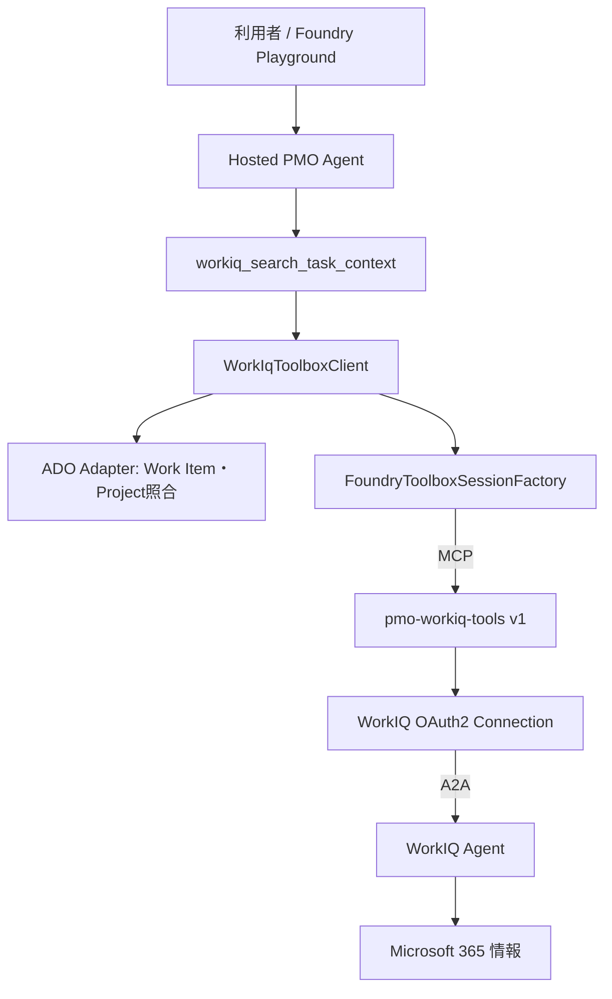
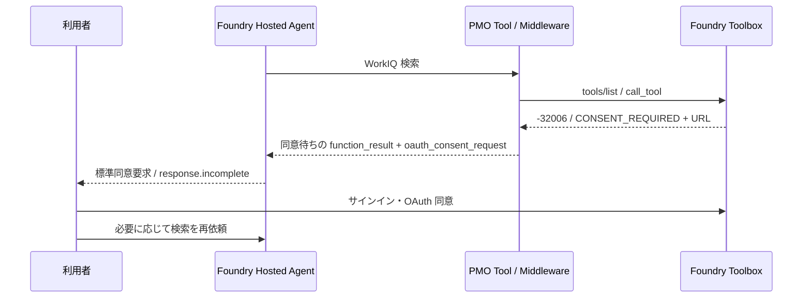

# WorkIQ の設計・実装状況・残課題

更新日: 2026-10-09。実装の参照点は `feat/pmo-workiq-toolbox` の `9337145`、直近の配備は Foundry Hosted Agent `test-hostedagent` v14。本書はその時点のコードと検証結果を整理したもので、Azure 設定を今回再取得したものではない。

本書は文書専用ブランチで作成後、`feat/pmo-workiq-toolbox` に取り込んだ。参照する WorkIQ 実装は同ブランチにあり、統合ブランチへの反映はまだ行っていない。初期計画は [導入前の WorkIQ 計画](archive/WORKIQ_IMPLEMENTATION_PLAN.md)、接続手順は [WorkIQ 接続手順](workiq-toolbox-setup.md)、全体の状態・課題は [実装状況](IMPLEMENTATION_STATUS.md) を参照する。

## 1. 目的と現在の到達点

ADO Work Item に関連する Microsoft 365 の情報を WorkIQ で調べ、PMO Agent が進捗や不足情報を説明できるようにする。検索結果から ADO を変更する場合は、既存の Proposal と個別承認の経路を利用する。

実 Adapter と標準 OAuth 同意処理を実装し、ローカルで回答取得、Hosted で同意要求の応答生成を確認した。利用者から同意完了と接続を確認できたとの報告を受けている。一方、関連する実データと回答・出典の一致、同意後の会話継続については体系的な検証が残る。認証・接続の成立と、検索結果の正確性は分けて判断する。

## 2. 接続構成と A2A の採用理由



Hosted Agent → Foundry Toolbox は MCP、Toolbox → WorkIQ は A2A。PMO が WorkIQ A2A endpoint を直接呼ぶ構成でも、WorkIQ MCP サーバーへ直接接続する構成でもない。

既存の Foundry Connection `WorkIQ` が `RemoteA2A` / `OAuth2` として構成されていたため、その接続を利用する方針にした。WorkIQ に自然言語の調査依頼を渡し、合成回答を受け取る方式が今回の PMO 用途に適合する。A2A が MCP より一般的に優れているという判断ではない。

### 今回の A2A 構成と WorkIQ MCP 直接接続の比較

| 観点 | 採用した Toolbox → WorkIQ A2A | WorkIQ MCP 直接接続 |
| --- | --- | --- |
| 呼び出し | WorkIQ Agent に調査・回答生成を依頼 | MCP が公開するツールを呼ぶ。具体的な能力は提供仕様による |
| 利点 | 既存 Connection と Foundry のユーザー同意処理を利用できる。調査を WorkIQ に委ねられる | ツールの契約が詳細なら、引数や処理手順を PMO 側で制御しやすい |
| 制約 | 内部の検索・操作を PMO が直接制御しにくい。現在の応答は合成回答中心 | 接続先、認証、Hosted 対応、VNet、ツール・応答契約の追加検証が必要 |
| 出典 | 現在は独立して検証できる出典レコードの変換を実装していない | 構造化した出典が得られるかはサーバー仕様次第 |
| 読み取り専用 | 現在の WorkIQ 権限では保証しない | MCP を採用するだけでは保証されず、ツールと権限次第 |
| 検証状況 | 現環境で同意・接続を確認 | 本実装では未検証 |

現段階では A2A を継続する。検索操作の厳密な制御や検証可能な出典取得が必要になった際に、MCP の実仕様を調べて比較する。MCP の採用だけで、出典の構造化や読み取り専用が実現するとは扱わない。

## 3. Azure 構成と認証

| 項目 | 現在の構成 |
| --- | --- |
| Foundry account | `aifoundry-techenablement-fde-hackathon-dev-jpe-001` |
| Foundry Project | `FDE-hackathon` |
| Hosted Agent | `test-hostedagent` v14 |
| WorkIQ Toolbox | 専用 `pmo-workiq-tools` v1 |
| WorkIQ Connection | 既存 `WorkIQ`、`RemoteA2A` / `OAuth2` |
| A2A 接続先 | `https://workiq.svc.cloud.microsoft/a2a/` |
| OAuth scopes | `offline_access`、`api://workiq.svc.cloud.microsoft/WorkIQAgent.Ask` |
| ネットワーク | Hosted Agent の VNet injection が有効な既存環境 |
| ADO 対象 | Organization `AI-Leap-JP` / Project `PMO-Agent` |

ローカルでは `AzureDeveloperCliCredential` による利用者認証を使う。Hosted では managed identity で Foundry へアクセスし、SDK のリクエスト call ID 転送で呼び出しコンテキストを維持する。WorkIQ の委任認証は Connection に任せる。WorkIQ 利用はユーザーのサインイン・同意が必要であり、Hosted Agent の managed identity だけによる app-only アクセスは今回の方式では実現しない。

MCP セッションは操作ごとに新規作成して閉じる。共有 MCP セッションやグローバルな可変ユーザー認証状態を保持しない。WorkIQ が返す task/context ID は継続呼び出しに再利用しない。

VNet injection 環境で Hosted から Toolbox への到達と同意フローは確認できている。利用者から接続確認の報告もあるが、あらゆる VNet・ネットワーク隔離構成の互換性を検証したものではない。

## 4. 検索・回答処理

1. `work_item_id` と `query` の型・長さを検証する。
2. 実 ADO Adapter から対象を取得し、Project を照合する。照合に失敗した場合は WorkIQ を呼ばない。
3. ID、タイトル（最大500文字）、担当者（最大256文字）を検索データにする。
4. 情報取得専用の固定依頼文を生成し、`WorkIQ___SendMessage` へ渡す。互換性のため残した `query` 引数は、自由な命令として転送しない。
5. `tools/list` でツール名と `message` 引数の存在を照合してから呼び出す。
6. A2A Task / Message の本文を変換し、PMO Tool へ合成回答を返す。

初期値は対象期間14日、取得依頼の目安10件、timeout120秒、最終回答上限20000文字。期間・件数は WorkIQ への依頼であり、サービス側の厳密な検索条件や検索完全性を保証しない。timeout・回答量はアダプターで制限する。

現在の正規化結果は次の形である。

```json
{
  "work_item_id": 5,
  "source_type": "workiq_synthesis",
  "summary": "WorkIQ が返した合成回答",
  "retrieved_at": "PMO が取得した時刻",
  "grounding_status": "unverified_citations",
  "evidence": [],
  "warning": "本文中の引用は検証が必要で、出典 ID・日時は推定していない"
}
```

これは出力構造の例であり、実データではない。`retrieved_at` はメール・会話の発生日時ではない。独立した source ID、source 日時、confidence は生成しない。本文の URL が存在しても、現段階では検証済みの根拠として扱わない。

isError、空・過大・不正な回答、明示的な未完了 Task は取得成功として返さない。timeout は明示的な取得失敗として返す。認証・権限・Connection 等の一般エラーは機密情報を含まないメッセージに変換する。失敗を空結果やモック根拠へ置換せず、自動 retry も行わない。

## 5. 標準 OAuth 同意フロー



`WorkIqConsentRequiredError` は、認証済み Toolbox の構造化された WorkIQ 同意エラーから取得した URL を保持する。検索結果本文やモデルが生成した URL は使わない。URL の HTTPS、ホスト形式、認証情報・制御文字等を検証する。リージョン別の独自 allowlist は撤去し、固定バージョンの Foundry Host の検証と整合させている。SDK private 関数は実装から直接利用せず、テストで互換性を照合する。

PMO Tool は `Content.from_oauth_consent_request` を返す。`WorkIqConsentMiddleware` は Tool 実行後に `UserInputRequiredException` で SDK に一時停止を伝える。Tool 本体の通常失敗として処理しないため、同意待ちで `Function failed` ログを発生させない。SDK が標準 `oauth_consent_request`（server_label=WorkIQ、consent_link付き）を伝播し、Host は `response.incomplete` で終了する。

同意要求だけでは元のモデル呼び出しが未完了のまま履歴に残り、次の発話で `No tool output found for function call` が発生した。v14 は同じ call ID の `function_result` を先に返して履歴を閉じ、その後に同意要求を返す。結果は `status=consent_required` で、認証・検索の成功とは扱わない。

URL を取得できない場合は、`consent_required` と Connection 確認案内へフォールバックする。同意を自動付与したり URL を自動で開いたりしない。同意後の自動再開は未検証であり、必要に応じて同じ会話で再依頼する。同意 URL・トークンは Git や診断記録へ保存しない。

## 6. 実装ファイルと設定

以下のファイルは本書と同じ WorkIQ 機能ブランチにある。

| ファイル | 責務 |
| --- | --- |
| `src/fde_pmo_agent/integrations/mcp/workiq.py` | 接続設定、検索依頼、応答変換、同意・取得エラー |
| `src/fde_pmo_agent/integrations/mcp/transport.py` | SDK の認証・call ID 転送を使う操作ごとの MCP セッション |
| `src/fde_pmo_agent/integrations/mcp/check_workiq.py` | 契約照合・明示的なローカル取得確認 CLI |
| `src/fde_pmo_agent/agent/tools.py` | PMO Tool、標準同意 Content、同意 Middleware、履歴の call 終端 |
| `src/fde_pmo_agent/agent/factory.py` | Middleware の登録、Agent の動作指示 |
| `src/fde_pmo_agent/hosting/foundry.py` | 実 WorkIQ Client と session runtime の結線 |
| `src/fde_pmo_agent/runtime.py` | session 単位のサービス構成、mock / disabled / 実 client の分離 |
| `src/fde_pmo_agent/settings.py` | 環境変数の検証と設定生成 |
| `skills/observe-task-board/SKILL.md` | 未検証の引用・同意待ち・取得失敗を区別するワークフロー |
| `azure.yaml` / `deploy/foundry/agent.yaml` | Hosted の非機密接続設定 |
| `tests/test_workiq_toolbox.py` | 契約・応答・同意・モデル停止・標準応答・結線のテスト |

```dotenv
WORKIQ_MODE=toolbox
WORKIQ_TOOLBOX_ENDPOINT=https://aifoundry-techenablement-fde-hackathon-dev-jpe-001.services.ai.azure.com/api/projects/FDE-hackathon/toolboxes/pmo-workiq-tools/versions/1/mcp?api-version=v1
```

`WORKIQ_MODE` は `disabled` または `toolbox` で、default は disabled。mock runtime は従来のモックを使い、実 ADO runtime で未接続の WorkIQ は disabled とする。実 WorkIQ と mock ADO の組合せは拒否する。

ツール名・timeout・期間・件数・回答上限は現行 `WorkIqToolboxConfig` の定数初期値。計画にある `WORKIQ_TIMEOUT_SECONDS` 等の環境変数は、現行 Settings にはまだ結線されていない。`WORKIQ_MCP_SERVER_URL` は設定の受け取りだけ残っており、この実装の接続先としては使用しない。

## 7. 確認済みの範囲

| 検証 | 結果と限界 |
| --- | --- |
| 専用 Toolbox の契約 | `WorkIQ___SendMessage` と引数 schema を実取得 |
| ローカル実取得 | azd 利用者認証で ADO ID5 に対する回答を取得。関連実データとの正確性を保証するものではない |
| Hosted の同意応答 | v12 の実 API で標準同意要求と `response.incomplete` を確認 |
| 同意画面・接続 | 利用者が同意画面への遷移、同意完了、接続確認を報告 |
| v14 の再発話 | 実呼び出しで400なし。ただし同意要求直後の再開を体系的には確認していない |
| 単体テスト | 2026-10-09に全71件成功。ADO Gateway の既存テストも維持 |

単体テストでは、合成回答の変換、未完了・空・過大・不正応答、ADO 照合失敗時の非呼び出し、同意・timeout、Hosted 結線、実 SDK での同意伝播とモデルループ停止、call ID に対応するツール結果、Host 標準応答、URL 検証互換性、同意待ち時の通常失敗ログ抑止を確認している。実 API を呼ぶテストは通常の単体テストに含めない。

## 8. 認可と運用上の制約

生の WorkIQ MCP ツールをモデルへ公開せず、照合済み ADO 情報と固定検索依頼を利用する。取得文中の命令は信頼しない。これらは任意命令を制限する設計である。

ただし `WorkIQAgent.Ask` は読み取り専用権限ではなく、固定の取得依頼も WorkIQ 内部の副作用を権限レベルで禁止する保証ではない。厳密な読み取り専用が必要なら、WorkIQ のサービス側 policy や専用検索 API の対応を調べる。

ADO の作成・更新・コメントは個別承認付き Gateway を維持する。WorkIQ 回答を取得しただけで自動更新しない。実メール・Teams メッセージ送信、予定作成は今回未実装で、実 runtime の送信は disabled。

PMO の Proposal、Audit、session runtime registry はプロセス内メモリ。Cosmos DB による業務状態・証跡の保存は未実装で、再起動・複数インスタンスでの復元や排他を保証しない。WorkIQ 合成回答の永続化も未実装。

## 9. 残課題と次の検証

全体の優先順位と完了条件の正本は [実装計画](IMPLEMENTATION_PLAN.md)。以下は WorkIQ 固有の検証観点であり、全体の状態判定は [実装状況](IMPLEMENTATION_STATUS.md) に集約する。

| 優先度 | 課題 | 完了条件 |
| --- | --- | --- |
| 高 | 実データ検索の妥当性 | 関連メール・Teams 会話が存在するタスクを使い、回答と参照リンク・日時を実データに照合する |
| 高 | 同意後の継続・再同意 | 同意要求 → 同意 → 同一会話で再検索を記録し、400再発なしを確認。失効・取消後の導線も確認する |
| 高 | 利用者別認証・権限 | 別ユーザー・未同意・権限不足で参照範囲、同意要求、ユーザー間の分離を確認する |
| 中 | 出典の構造化 | サービスが実際に返す出典情報を確認し、検証可能な source と合成回答を分けて保存・表示する |
| 中 | 検索・エラー分類 | タイトル・担当者以外の照合キー、期間・件数・timeoutの設定化、認証/権限/Connection障害の分類を検討する |
| 中 | Harness の実行安定性 | 検証中に発生した計画・実行モード切替の引数解析エラーを再現・解消する |
| 本番前 | 読み取り専用の保証 | WorkIQ のサービス側制約を確認し、求める認可境界に合う構成を選ぶ |
| 本番前 | 永続化・監視 | Cosmos DB の保存・復元・排他、保存期間、ユーザー情報を漏らさない監視と照合手順を実装・検証する |

同意画面を再撮影する場合、新規会話だけでは再同意要求が出るとは限らない。未同意の検証ユーザーか、ユーザー単位の接続解除・再同意を検討する。現在の共有 Connection / Toolbox を削除しない。解除方法・影響範囲は未検証であり、今回実行していない。

最初の次作業は、既知の関連データがある ADO タスクを1件選び、Hosted 検索、参照リンク照合、同じ会話での再検索を記録すること。この検証が通れば、WorkIQ の初期接続実装の完了判断を行える。

## 10. 参照資料

- [Foundry WorkIQ tool](https://learn.microsoft.com/en-us/azure/foundry/agents/how-to/tools/work-iq)
- [Hosted Agent で Toolbox を使う](https://learn.microsoft.com/en-us/azure/foundry/agents/how-to/tools/use-toolbox-hosted-agent)
- [Toolbox network isolation](https://learn.microsoft.com/en-us/azure/foundry/agents/how-to/tools/toolbox-network-isolation)
- [WorkIQ A2A quickstart](https://learn.microsoft.com/en-us/microsoft-365/copilot/extensibility/work-iq/a2a/quickstart)

公式資料の URL は既存調査の参照先であり、本書作成時にサービスの最新仕様を再検証したものではない。SDK の同意伝播は現行固定バージョンを読み、実行テストで確認した。
